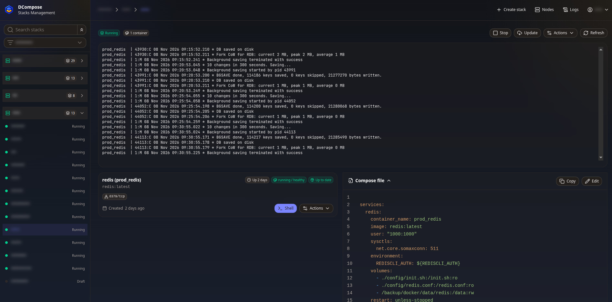

# DCompose


DCompose manages your compose stacks on local and remote hosts from one web interface. The project is
inspired by [Dockge](https://github.com/louislam/dockge).

> [!WARNING]
> DCompose is still in active development and has not reached its first release. Expect bugs and configuration changes.

## Screenshots



## Regular setup

Run one `dcompose` server for the web interface and one `dagent` on each host you want to manage.
Only `dagent` needs access to Docker or Podman.

## Installation

On Linux, run the installer and choose server, node, or both:

```sh
curl -fL https://raw.githubusercontent.com/arabcoders/dcompose/master/install.sh -o install.sh
bash install.sh
```

See [Installation](installation.md) for requirements. For manual setup, use the Docker instructions below or the
[native and Podman instructions](packaging/README.md).

## Docker deployment

Install Docker with Compose 2.35 or later. For Podman, use the [Podman instructions](packaging/README.md#podman-nodes).

Download [compose.yaml](compose.yaml), then run:

```sh
echo "DCOMPOSE_UID=$(id -u)" >> .env
echo "DCOMPOSE_GID=$(id -g)" >> .env
install -d -m 0750 config/dcompose config/dagent
sudo install -d -m 0750 /opt/stacks
docker compose up -d
docker compose logs dagent
```

Open `http://<server-ip>:8080` and create your account. Then open **Nodes > Add node** and enter `dagent:9077`
and the **Pairing token** from the logs.

To add a node on another host, see [connecting nodes](FAQ.md#why-cant-my-node-connect).

### Your first stack

Click **Create stack**, choose a connected node and name the stack. Enter its Compose configuration and expand
**.env** if you need interpolation variables. **Save** writes the files without changing containers;
**Save and deploy** also starts the stack. A saved stack with no containers is shown as **Draft**.

For existing deployments, see [using existing stacks](FAQ.md#how-do-i-use-existing-stacks).

### Private registries

Open **Settings > Registries** to add your registry logins. You can import Docker's `config.json`, edit the entries,
and choose which ones to save. Each entry keeps its Docker auth fields, with an optional label and a background-check setting.
Credentials stored in a helper or OS keychain must be entered manually.

Enable background checks on the account you want the global checker to use. Pulls, deployments,
manual checks and checks with their own timer can use any matching login, preferring accounts not used for background checks.

DCompose sends saved credentials to every node, including changes made while a node was disconnected. You don't need
to mount your host's Docker configuration. See [automatic updates](FAQ.md#how-do-i-enable-automatic-updates) to opt in to updates.

### Updating containers

From your installation directory, run:

```sh
docker compose pull
docker compose up -d
```

For release tags and native binaries, see [upgrading](installation.md#upgrading).

## Security

> [!IMPORTANT]
> Anyone who can sign in can edit stacks and open container shells. Treat access to DCompose like access to your hosts.

Create your account before making the site public. Put it behind an HTTPS reverse proxy and allow only the server
to reach your nodes. If you use SSO, limit access to the client at your identity provider. Everyone it accepts signs 
in as the same administrator.

## Documentation

- [Server configuration](dcompose.example.toml)
- [Node configuration](dagent.example.toml)
- [FAQ](FAQ.md)
- [Security policy](SECURITY.md)
- [Contributing](CONTRIBUTING.md)

## Project policy

DCompose is built for my own needs and use cases. Discuss contributions with me and get approval before starting work. 
Unsolicited pull requests will be declined. Read [CONTRIBUTING.md](CONTRIBUTING.md). I use AI tools in this project. 
You're welcome to use DCompose if it works for you. However, if you object to AI tools, then simply put, this project 
is not good fit for you. Build your own using technologies you approve of.

## Other projects

- [YTPTube](https://github.com/arabcoders/ytptube): Download manager and automation interface for yt-dlp.
- [WatchState](https://github.com/arabcoders/watchstate): Sync play states between media servers without third-party services.
- [Millwright](https://github.com/arabcoders/millwright): automation interface for FFmpeg.
